# Factory Energy AI Demo

An energy command center for a **fictional electronics plant**: demand management, AI load
forecasting and equipment anomaly detection, driven by a deterministic plant simulator with
labelled scenarios.

> **All data is synthetic.** "DemoTronics Electronics Plant" does not exist. Costs use the
> structure and prices of Taiwan's high-voltage three-segment time-of-use tariff, shown as NT$
> with a US$ equivalent.

<p align="center">
  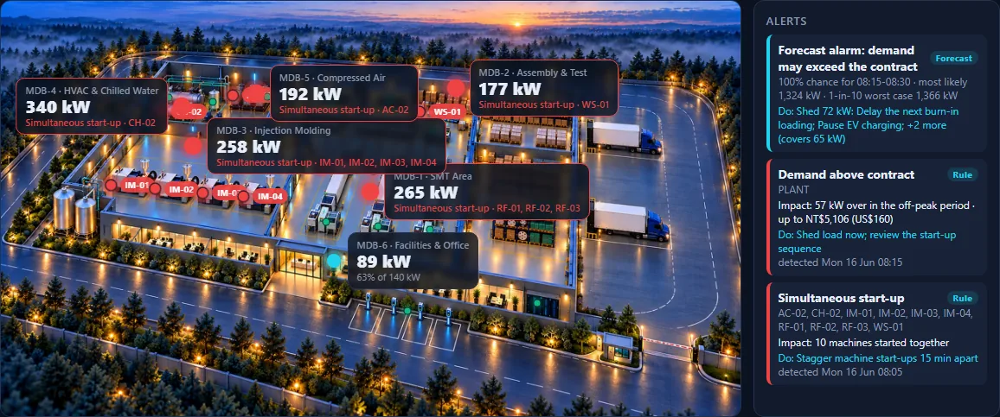
</p>

*The home page during the Monday start-up (scenario S2): every board is red, demand is above the
contract. The plant illustration is AI-generated from a written brief and depicts no real site;
only the anchored numbers mean anything.*

## Why it matters

A factory's electricity bill is not only about energy (kWh). Industrial tariffs also charge for
**demand**: the average power over each 15-minute interval. Under Taiwan's high-voltage tariff the
plant agrees a **contract capacity** with the utility; if the month's highest 15-minute demand
goes above it, the excess is billed at **twice** the contract price up to 10% over, and **three
times** beyond. One bad quarter of an hour sets the penalty for the whole month, and the time of
day matters: the same excess costs five times more in the summer peak (16:00–22:00) than in the
off-peak morning. So knowing a few minutes earlier is worth real money. The rest is the slow kind
of waste nobody sees on the bill: a machine left on, an air leak, a tripped capacitor bank.

This project shows what an energy team can do with the meter data they already have: watch the
15-minute demand live, forecast it, catch equipment problems early, and attach a kW, a cost
(NT$ and US$) and an action to every alert. The approach has been verified on real panel meters
in a working plant; this public version runs on synthetic data because that plant's data is
confidential.

**Contents:** [Demand management](#1-demand-management) · [AI load forecasting](#2-ai-load-forecasting) ·
[Equipment anomalies](#3-equipment-anomalies) · [Six cases](#six-cases) ·
[Results](#results-at-a-glance) · [Limitations](#limitations) · [The plant](#the-plant) ·
[Glossary and FAQ](#glossary-and-faq) · [Quick start](#quick-start) · [Demo video](#demo-video)

## 1. Demand management

Monday 08:00: four moulders, three reflow ovens, the wave-solder machine, the large chiller and
the standby compressor start at once. The 15-minute demand hits **1,324 kW** on a **1,250 kW**
contract.

- A start-up rule flags the simultaneous start at 08:05 and names the ten machines.
- The demand page projects the running interval and lists what can be shed right now, with the
  kW each action covers.
- A what-if re-simulates the same morning with the machines started 15 minutes apart:
  **1,324 → 1,142 kW**, back under the contract with no new equipment.

<p align="center">
  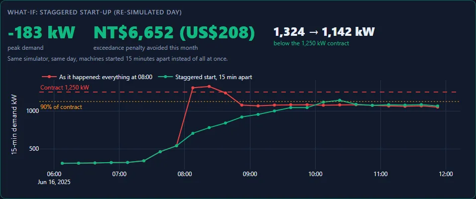
</p>
<p align="center">
  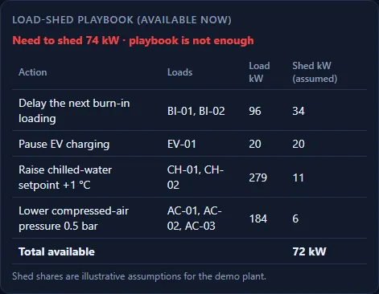
</p>

<p align="center">
  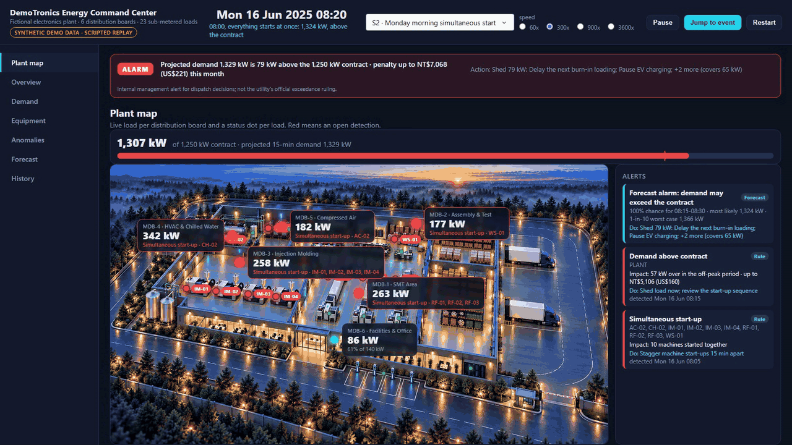
</p>

## 2. AI load forecasting

Quantile gradient boosting (LightGBM), 15 minutes to 3 hours ahead, trained only on data before
each forecast. The 10–90% band is calibrated to cover 80% of outcomes and becomes a probability
of exceeding the contract: 20% raises a warning, 50% an alarm.

- During the heat wave (scenario S3) sustained overruns are warned **30 to 75 minutes ahead**.
- One hour ahead the typical error is **11.8 kW (1.9% of demand)**, 74% better than assuming the
  load stays as it is.
- The leaderboard is honest: a spreadsheet-style weekly profile, a linear model, a second tree
  model (scikit-learn HGB) and an ensemble, same features, same backtest.

<p align="center">
  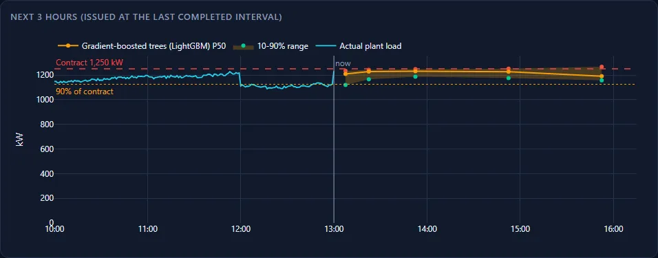
</p>
<p align="center">
  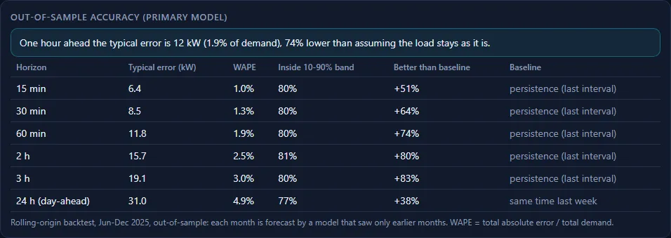
</p>
<p align="center">
  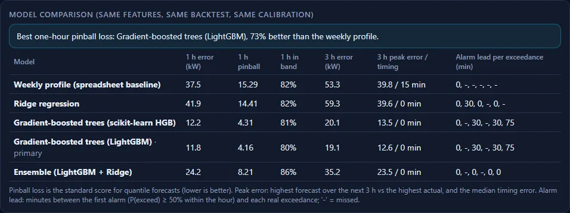
</p>

<p align="center">
  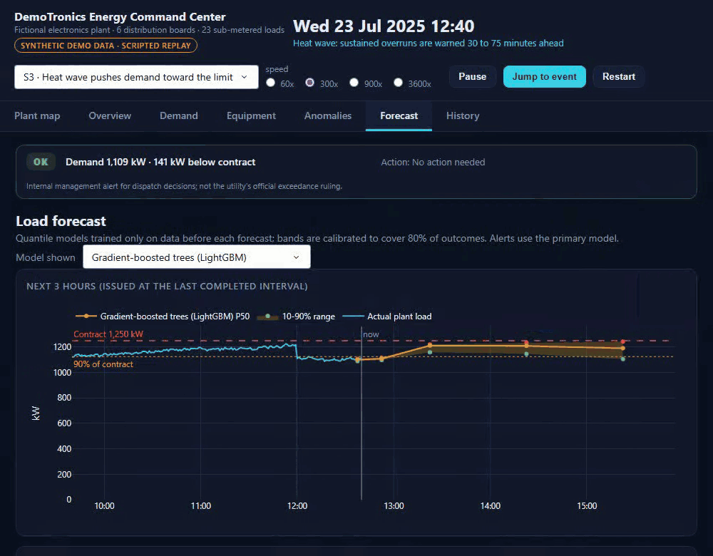
</p>

## 3. Equipment anomalies

Three layers, each for what it is good at: rules for things with a clear definition (running
outside schedule, low power factor, demand above contract), a CUSUM baseline on the night load
for slow drift, and an Isolation Forest on daily load fingerprints for the rest, reported as
low-severity hints.

- A reflow oven left in standby all weekend (**4.5x** the normal weekend energy) is flagged at
  23:00 on Friday.
- A compressed-air leak (**+18 kW** around the clock, about NT$650k / US$20k a year) is caught after eight
  nights, once it stands out from the noise.
- Every alert carries its impact in kW and money (NT$ with US$) and the action to take.

<p align="center">
  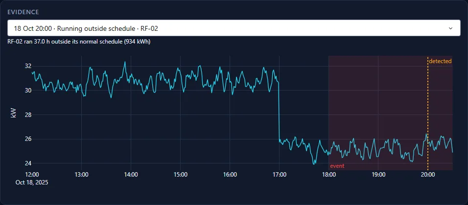
</p>
<p align="center">
  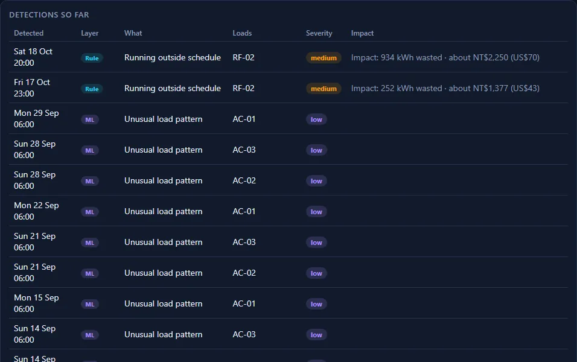
</p>

<p align="center">
  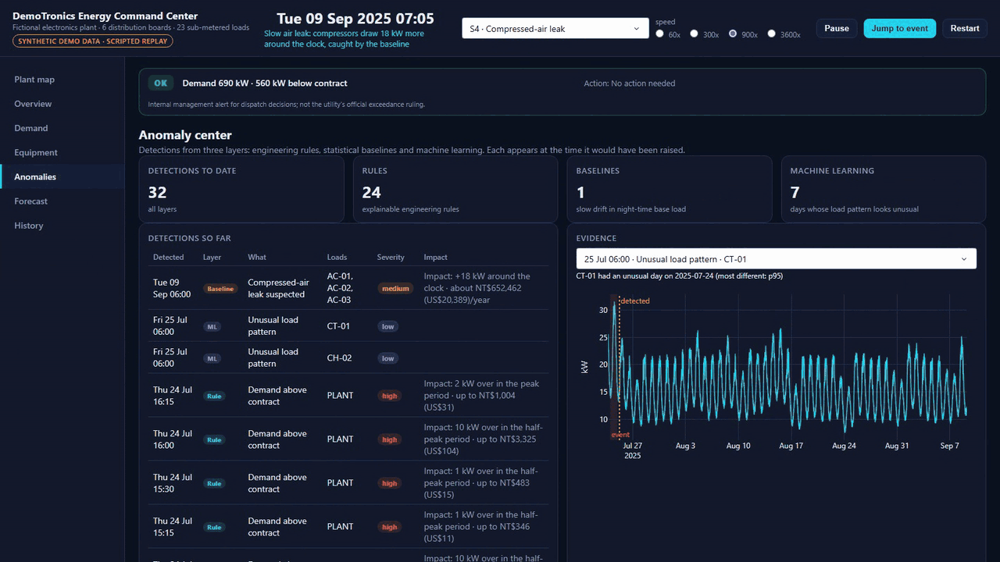
</p>

The other pages: [Overview](docs/assets/screens/overview.webp) (KPIs, load against the forecast
bands, alerts), [Equipment](docs/assets/screens/equipment.webp) (every sub-metered load, red when
a detection is open) and [History](docs/assets/screens/history.webp) (where the energy goes over
the year). The full walkthrough video is at the [end of this page](#demo-video).

## Six cases

Each scenario in the simulator is a realistic incident with a ground-truth label, so every
detection can be checked. The table is the summary; the cards below tell each story in the same
four steps: what happened, how it was caught, what to do, what it cost.

| Case | What went wrong | Caught by | Impact |
|---|---|---|---|
| [S1](#s1--a-normal-week) | Nothing: the reference week | – | Weekday peaks 1,060–1,135 kW, night base load about 500 kW |
| [S2](#s2--everything-starts-at-0800) | Ten machines start at 08:00 | Start-up rule, 08:05 | 1,324 kW on a 1,250 kW contract; staggering gives 1,142 kW |
| [S3](#s3--a-three-day-heat-wave) | Heat wave, chillers lose efficiency | AI forecast | 21 intervals just above contract; warned 30–75 min ahead |
| [S4](#s4--a-compressed-air-leak) | Air leak grows to 18 kW | Night-load baseline | Caught after 8 nights; about NT$650k (US$20k) a year if left |
| [S5](#s5--a-reflow-oven-left-on-all-weekend) | Reflow oven left on all weekend | Off-schedule rule, Fri 23:00 | 4.5x the normal weekend energy |
| [S8](#s8--a-capacitor-bank-trips) | Capacitor bank trips | Power-factor rule, 68 min | Power factor 0.96 → 0.84: bill credit falls from 1.5% to 0.4% |

### S1 · A normal week

**What happened.** Nothing, on purpose. 4–10 August is a plain production week: day, overtime
and night shifts on weekdays, half the plant on Saturday, maintenance only on Sunday.<br>
**Why it is here.** Every other case is judged against it. Weekday peaks are 1,060–1,135 kW,
Saturday 750 kW, Sunday 420 kW, and the night base load sits around 500 kW. A good detector must
stay quiet on this week, and it does: no rule or baseline fires.

<p align="center">
  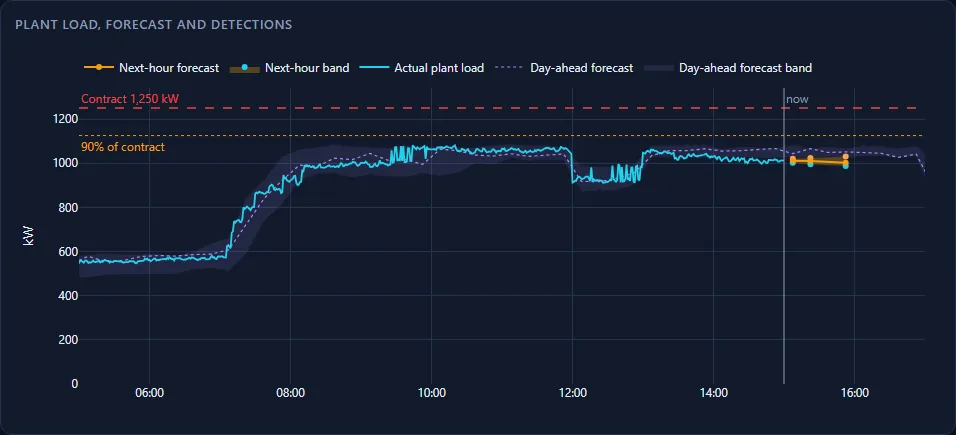
</p>

*Overview on Wednesday 6 August: actual load inside the day-ahead band, well under the contract, and no detection markers.*

### S2 · Everything starts at 08:00

**What happened.** Monday 16 June, after the weekend. At 08:00 sharp the operators switch on all
four injection moulders, the three reflow ovens, the wave-solder machine, the large chiller and
the standby air compressor. Their start-up surges overlap.<br>
**How it was caught.** The start-up rule looks for at least six machines going from off to more
than 40% of their rating within three minutes. It fired at 08:05 and named all ten machines. The
15-minute demand was above the contract for two intervals, 08:00–08:30.<br>
**What to do.** Right now: the load-shed playbook lists what can be dropped (delay the next
burn-in load, pause EV charging, raise the chilled-water setpoint, lower the air pressure).
Next Monday: start the machines 15 minutes apart.<br>
**Impact.** 1,324 kW against 1,250 kW. In summer 08:15 is still off-peak under the
three-segment tariff, so the 74 kW excess is billed at the cheap off-peak contract price:
NT$6,652 (US$208) for the month. The same surge at 16:00 would cost NT$33,277 (US$1,040).
Re-simulating the morning with a staggered start gives 1,142 kW, under the contract, with no
new equipment.

<p align="center">
  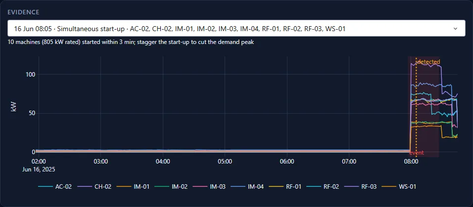
</p>

*Anomaly center, evidence for the start-up rule: ten machines jump from standby at 08:00 within three minutes; the dotted line is when the rule fired.*

### S3 · A three-day heat wave

**What happened.** 22–24 July, afternoons up to 5.5 °C hotter than normal (39.9 °C at the peak).
The chillers run harder and lose efficiency, and the afternoon demand creeps up to the
contract.<br>
**How it was caught.** The forecast. Its 10–90% band turns into a probability of exceeding the
contract; 50% raises an alarm. The sustained overruns were warned 30 to 75 minutes ahead; two
single-interval blips were missed.<br>
**What to do.** Use the warning time: pre-cool before the peak, hold non-essential start-ups, be
ready to pause EV charging.<br>
**Impact.** Daily peaks of 1,209, 1,263 and 1,267 kW; 21 intervals above the contract, each by
only 1–17 kW. This is the case a rule cannot catch early and a forecast can.

<p align="center">
  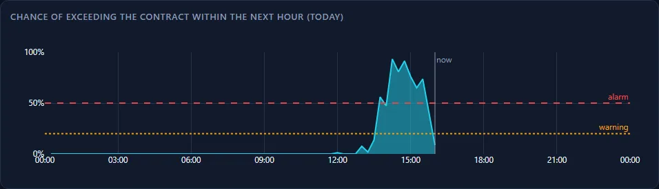
</p>

*Demand page on 23 July: the forecast's chance of exceeding the contract crosses the 50% alarm line from about 14:00, ahead of the afternoon overruns.*

### S4 · A compressed-air leak

**What happened.** From 1 September a leak opens in the compressed-air network and grows over
three weeks to 18 kW of extra compressor load, until it is repaired on 29 September.<br>
**How it was caught.** A CUSUM baseline on the compressors' night-time load, when production is
off and any extra draw is waste. It raised the alarm on 9 September, eight nights in, as soon as
the drift stood out from normal night-to-night noise.<br>
**What to do.** Walk the air network with an ultrasonic leak detector, fix the leak, then confirm
the night load is back to normal.<br>
**Impact.** +18 kW around the clock, about NT$650,000 (US$20,000) a year if it had been left.

<p align="center">
  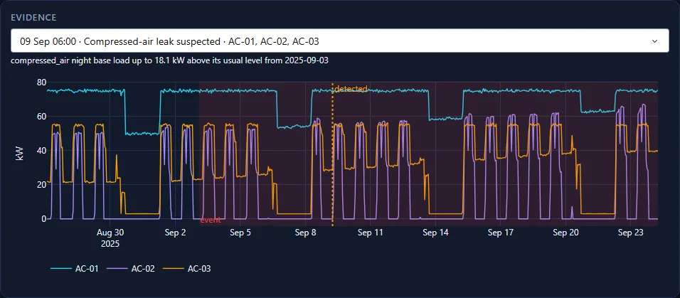
</p>

*Anomaly center, evidence for the night-load baseline: the compressors' night and weekend load creeps up through September until the alarm on 9 September.*

### S5 · A reflow oven left on all weekend

**What happened.** On Friday 17 October the second reflow oven is put in standby instead of
being switched off. It holds temperature through Friday night, runs with the Saturday shift, then
sits idle again until Monday 07:15.<br>
**How it was caught.** The off-schedule rule compares each machine with the hours it normally
runs. RF-02 was flagged at 23:00 on Friday, after two hours above 20% of its rating at a time it
is almost always off, and again on Saturday evening.<br>
**What to do.** Switch the oven off at the end of the last shift; add it to the Friday shutdown
checklist.<br>
**Impact.** 1,556 kWh that weekend against about 346 kWh on a normal one: 4.5 times the energy,
for no production.

<p align="center">
  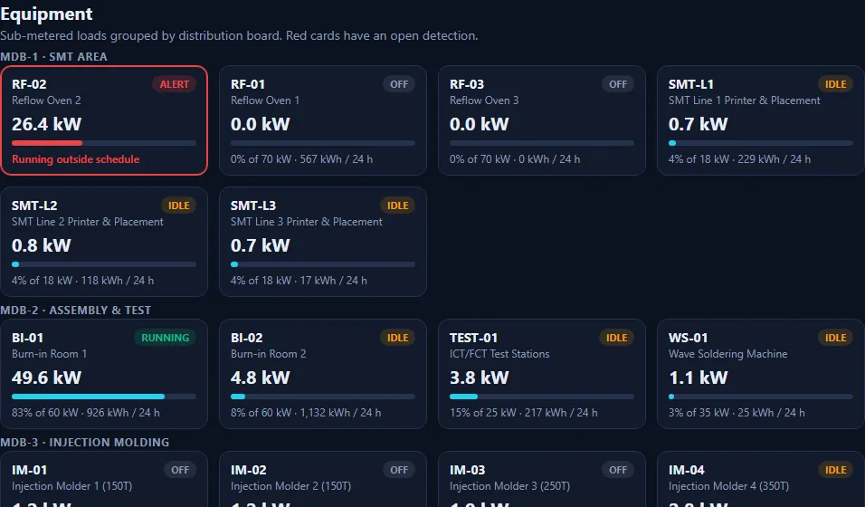
</p>

*Equipment page on Saturday night: RF-02 is the only reflow oven still drawing power, flagged in red as running outside its schedule.*

### S8 · A capacitor bank trips

**What happened.** On 3 November at 09:00 the power-factor correction capacitors on the
injection-moulding board trip. The moulders' reactive power is no longer compensated.<br>
**How it was caught.** The power-factor rule: below 0.90 for an hour, an early warning set well
above the tariff's 0.80 surcharge line. It fired at 10:08, 68 minutes after the trip, and pointed
at MDB-3.<br>
**What to do.** Check and reset the capacitor bank. Maintenance repaired it on 12 November.<br>
**Impact.** The board's power factor fell from 0.96 to 0.84. Taipower adjusts the whole monthly
bill by 0.1% per point from 80%: at 0.95 or better the bill is 1.5% lower, at 0.84 only 0.4%,
and below 0.80 a surcharge starts. The extra current also heats cables and transformers.

<p align="center">
  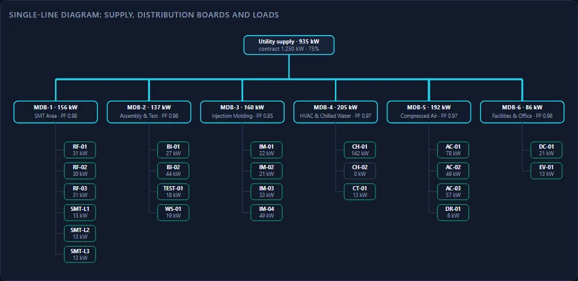
</p>

*Single-line diagram on 5 November: MDB-3 (injection moulding) runs at power factor 0.85 while the other boards stay at 0.97–0.98.*

The full scenario definitions are in [docs/scenarios.md](docs/scenarios.md).

## Results at a glance

| Result | Value |
|---|---|
| Forecast, 1 hour ahead | typical error 11.8 kW (WAPE 1.9%), 74% better than persistence |
| Forecast, 3 hours ahead | typical error 19.1 kW (WAPE 3.0%), 83% better than persistence |
| Next-3-hour peak | forecast peak is off by 12.6 kW on average, with no median timing error |
| Forecast, model comparison (1 h) | LightGBM 11.8 kW error, HGB 12.2 kW, vs 37.5 kW for the spreadsheet-style profile baseline and 41.9 kW for a linear model |
| Labelled incidents detected | 27 of 27 (rules: 100% precision) |
| S3 heat-wave warning | sustained overruns warned 30 to 75 minutes ahead; 2 brief blips missed |
| S2 what-if (staggered start-up) | -183 kW peak (1,324 to 1,142 kW), NT$6,652 (US$208) of off-peak exceedance avoided this month (simulated) |

## Limitations

- The dashboard replays a pre-built database; nothing is measured live.
- Detection thresholds were tuned on the same synthetic plant they are scored on.
- The S2 spike is caught by a rule in real time, not predicted by the forecast.
- The S3 forecast alerts miss two single-interval exceedances (about 1 kW and 17 kW over the contract) and raise 4 warning hours and 2 alarm hours of false alarms.
- The ML anomaly layer has 68% precision. The tariff models only a regular contract (no extra
  half-peak or off-peak contracts), and the NT$32 = US$1 exchange rate is illustrative.
- The forecast is easier on synthetic data. On real meter data from a working plant the same
  approach gave a typical error of about 2%, 3.5% and 5% of demand at 15 minutes, 1 hour and
  3 hours ahead, roughly twice this benchmark, because real demand has unscheduled events the
  simulator does not generate.

<details>
<summary><b>Forecast leaderboard</b> (typical error in kW, WAPE in brackets)</summary>

June to December, out-of-sample. Persistence is the baseline up to 3 h; same time last week at 24 h.

| Horizon | Baseline | LightGBM | HGB | Ensemble | Linear | Profile |
|---|---|---|---|---|---|---|
| 15 min | 13.1 | 6.4 (1.0%) | 6.4 (1.0%) | 9.9 (1.6%) | 15.1 (2.4%) | 15.2 (2.4%) |
| 1 h | 44.8 | 11.8 (1.9%) | 12.2 (1.9%) | 24.2 (3.8%) | 41.9 (6.6%) | 37.5 (5.9%) |
| 3 h | 112.7 | 19.1 (3.0%) | 20.1 (3.2%) | 35.2 (5.5%) | 59.3 (9.3%) | 53.3 (8.4%) |
| 24 h | 49.8 | 31.0 (4.9%) | 32.0 (5.0%) | 41.8 (6.6%) | 61.6 (9.7%) | 55.5 (8.7%) |

HGB is scikit-learn's histogram gradient boosting. It tracks LightGBM within about 5% and is a
dependency-light alternative. Simple models are worse than persistence at 30 minutes and below.
The 30 min and 2 h horizons are in [docs/forecasting.md](docs/forecasting.md). For comparison,
on real meter data from a working plant the same approach reached a WAPE of about 2% at 15 min,
3.5% at 1 h and 5% at 3 h, roughly twice the synthetic figures above.

</details>

## The plant

| Feeder | Area | Metered equipment |
|---|---|---|
| MDB-1 | SMT | 3 reflow ovens, 3 printer/placement lines |
| MDB-2 | Assembly & Test | 2 burn-in rooms, wave soldering, ICT/FCT stations |
| MDB-3 | Injection Molding | 4 injection molders (150–350 T) |
| MDB-4 | HVAC & Chilled Water | 2 chillers, cooling tower & pumps |
| MDB-5 | Compressed Air | 2 fixed-speed + 1 VSD compressor, air dryer |
| MDB-6 | Facilities & Office | server room, EV charging bank |

Contract capacity is **1,250 kW** on a 15-minute demand interval. The six feeders add up to the
plant total; the 23 equipment sub-meters are used for drill-down and anomaly detection. The areas
are laid out along the material flow (receiving, SMT and moulding, assembly and test, shipping,
with the utility plant in the back corner); see
[docs/simulator.md](docs/simulator.md#plant-layout-and-process-flow).

## Glossary and FAQ

<details>
<summary><b>Glossary</b>: the terms used on this page</summary>

| Term | Meaning |
|---|---|
| 15-minute demand | Average power over a quarter of an hour; what the utility bills as "demand". |
| Contract capacity | The demand the plant agreed with the utility (1,250 kW here). Excess is billed at 2x the contract price up to 10% over, 3x beyond. |
| Three-segment time-of-use | Taipower's peak / half-peak / off-peak pricing; in summer the peak is 16:00–22:00 on weekdays. |
| Persistence | The naive forecast "the next interval will be like the last one"; the baseline to beat. |
| P50, 10–90% band | The most likely value, and the range that should contain 8 outcomes out of 10. |
| WAPE | Total absolute error divided by total demand: the forecast error as a share of the load. |
| Pinball loss | The standard score for forecasts with bands; lower is better. |
| CUSUM | A running sum of small deviations; it detects slow drift that is invisible day to day. |
| Isolation Forest | A machine-learning method that flags days whose load shape is unlike the others. |
| Power factor | How much of the current does useful work. Taipower credits 0.1% of the bill per point above 80% (up to 95%) and charges 0.1% per point below. |
| Load shedding | Temporarily reducing non-critical loads to stay under the contract. |

</details>

<details>
<summary><b>FAQ</b></summary>

**Why synthetic data?** The approach has already been verified on real panel meters in a
working plant, but that plant's data is confidential, and real data has no answer key. A
simulator with labelled scenarios makes every number on this page checkable: each detector is
scored against what really happened.

**Does it work with real meters?** Yes. Everything after the simulator reads one table of
1-minute readings (`meter_reading_minute`: meter, time, kWh, kW, power factor, voltages,
currents) plus a production calendar and the outdoor temperature. In the real installation a
gateway polls three-phase panel meters over RS-485 / Modbus and writes exactly that kind of
table; see [docs/simulator.md](docs/simulator.md#output-tables).

**How accurate would it be on a real plant?** On real meter data from a working plant, the same approach gave a typical error of about 2% of demand 15 minutes ahead, 3.5% one hour ahead and 5% three hours ahead, roughly twice the error shown here,
because real demand has unscheduled events the simulator does not generate: unplanned stops,
rush orders, start-ups earlier or later than planned, meter gaps. Detection thresholds also need
tuning on the plant's own history.

**Why rules and machine learning, not only machine learning?** Rules are exact, explainable and
fast for problems with a clear definition, such as a simultaneous start. Machine learning helps
with the patterns nobody wrote a rule for, so it is shown as a low-severity hint, not an alarm.

**What does it take to run?** A laptop. `build-demo` simulates a year, runs detection and the
forecast backtest in about five minutes and writes a 1.2 GB DuckDB file; the dashboard runs
locally.

**Is the tariff real?** The structure and unit prices are Taipower's high-voltage three-segment
time-of-use tariff with a fixed peak (approved 17 November 2025): summer from 16 May to 15
October, exceedance at 2x / 3x the contract price, power-factor adjustment around 80%. The demo
plant holds only a regular contract, and the US$ figures use an illustrative NT$32 = US$1; see
[docs/dashboard.md](docs/dashboard.md#tariff).

</details>

## Quick start

```bash
python -m factory_energy check-config
python -m factory_energy simulate --start 2025-01-01 --days 365 --seed 42 --out data/plant.duckdb --force
# optional: --scenarios all (default) | none | S2,S3
python -m factory_energy detect --db data/plant.duckdb   # add --no-ml to skip the ML layer
python -m factory_energy forecast --db data/plant.duckdb # backtest + exceedance alerts (first run takes minutes, ~2.5 s when nothing changed)
# forecast reuses cached backtest units; --refresh reruns all, --models profile,hgb,lightgbm restricts, --workers N sets processes
python -m factory_energy build-demo                      # simulate + detect + forecast in one go
python -m factory_energy dashboard                       # http://127.0.0.1:8731 (local only)
```

This writes one year of 1-minute synthetic data to DuckDB. See [docs/simulator.md](docs/simulator.md)
for how the simulator works and [docs/scenarios.md](docs/scenarios.md) for the labelled incident
scenarios (`--scenarios`). `detect` runs the three anomaly-detection layers, writes the
`detections` table and prints precision/recall against the labels; see
[docs/anomaly_detection.md](docs/anomaly_detection.md). `forecast` runs the rolling-origin
load-forecast backtest and demand-exceedance alerts; see [docs/forecasting.md](docs/forecasting.md). `build-demo` prepares all of it and `dashboard`
serves the command center with scenario replay; see [docs/dashboard.md](docs/dashboard.md). The
first thing the dashboard shows is the plant map: an illustration of the fictional plant with live
kW, loading and alerts anchored on each distribution board.

## Architecture

```text
Plant simulator (equipment state machines + schedule + weather + scenario injection)
        │  1-minute readings + ground-truth event labels
        ▼
DuckDB  ──►  Energy engine (plant kW, kWh, 15-min demand, ranking)
        ├─►  Forecasting (gradient boosting, quantile bands, backtest)
        ├─►  Anomaly detection (rules → statistical baselines → ML)
        ▼
Dash / Plotly command center with scenario replay
```

## Roadmap

See [docs/roadmap.md](docs/roadmap.md).

## Development

```bash
conda env create -f environment.yml
conda activate factory-energy-ai   # includes scikit-learn and LightGBM
python -m factory_energy check-config
ruff check .
mypy src
pytest
```

## Demo video

The full scripted walkthrough, 2 min 40 s, 1920x1080, silent with captions: three chapters,
demand management, AI load forecasting and equipment anomalies, each introduced by a title card.

[**▶ Watch docs/assets/demo.mp4**](docs/assets/demo.mp4) (GitHub opens it in its own player)

<p align="center">
  <a href="docs/assets/demo.mp4">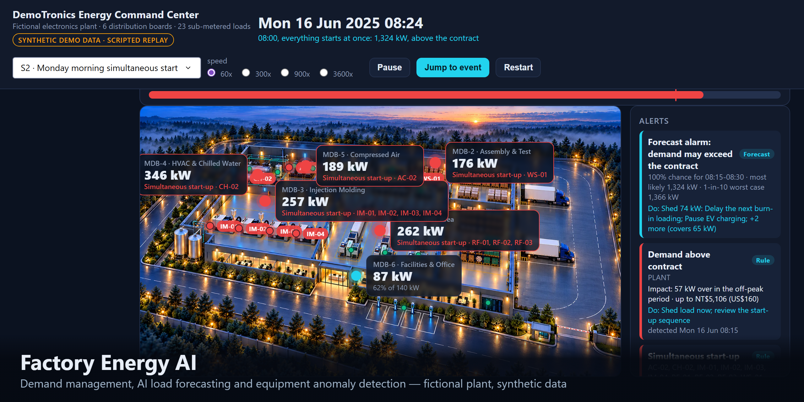</a>
</p>

## License and notices

The code, documentation and demo media are released under the [MIT License](LICENSE)
(© 2026 Howard159357). You may use, copy, modify and redistribute them, including commercially, as long
as the copyright notice and the licence text stay with them. The software comes with no warranty.

- **Data.** Every reading, label and figure is generated by the simulator in this repository;
  there is no real plant data.
- **Plant illustration.** AI-generated from a written brief for this project. It depicts no real
  site and is released under the same licence.
- **Tariff.** The time-of-use structure and unit prices are taken from Taiwan Power Company's
  published high-voltage tariff table (approved 17 November 2025) for illustration. This project
  is not affiliated with or endorsed by Taiwan Power Company and is not a billing tool; check the
  current tariff before using any figure for a real decision.
- **Dependencies.** Dash, Plotly, DuckDB, pandas, NumPy, scikit-learn, LightGBM, pydantic and
  PyYAML keep their own open-source licences (MIT or BSD).
- **Security.** See [SECURITY.md](SECURITY.md) to report a vulnerability privately.
